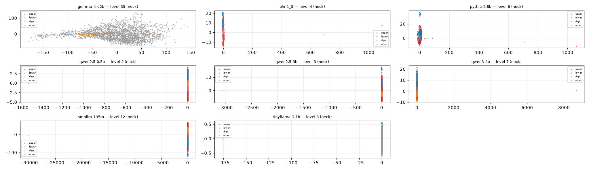
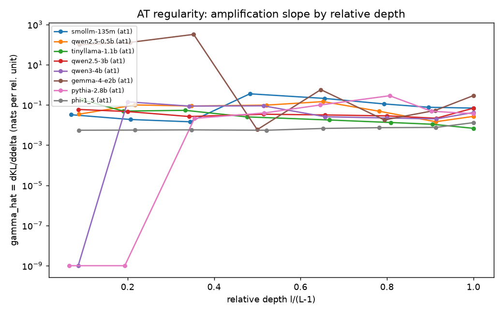
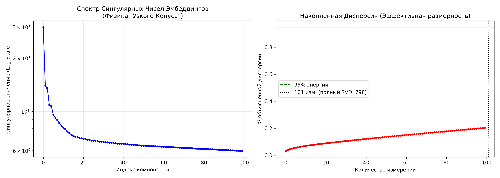

# Hourglass Lab

Эмпирическое исследование «часового песочника» в геометрии скрытых состояний LLM:
низкоразмерная «шея» посередине стека, анизотропия эмбеддингов, архитектурная интерференция
как имплицитный регуляризатор. Восемь базовых моделей пяти архитектурных семейств (0.135B–5.12B).



## Что исследуется

Трёхуровневая геометрия: веса (**W**), скрытые представления (**X**) и функция (**F**).
Показано, что уровни лишь частично зависимы, а «часовой песочник» (узкое место посередине стека) —
регулярное свойство всех семейств моделей.

- **Шея** — PCA средних слоёв: низкоразмерное подпространство между входным и выходным блоками;
- **Анизотропия / давление массы** — эффективный ранг, PR-профили по моделям и слоям;
- **Архитектурная интерференция** — теоремы аналогии (AT-1…AT-4) против null-моделей.

## Структура

```
hourglass-lab/
├── tvu_common.py          # общий модуль путей и моделей ($MODELS_DIR)
├── code/                  # основная работа: 72 скрипта + bat-запускатели
├── data/                  # результаты прогонов: 41 JSON метрик + 28 PNG фигур статей
└── hourglass-anatomy/     # концепт-проверка v1–v4 (CPU) + results/
```

Две части:

- **`code/`** — основная работа (aiir-hourglass): 8 моделей (Qwen2.5-0.5B / Qwen2.5-3B /
  Qwen3-4B, TinyLlama-1.1B, Pythia-2.8B, Phi-1_5, SmolLM-135M, Gemma-4-E2B). Эксперименты
  Exp5–Exp10c, теоремы аналогии (AT-1…AT-4), null-модели, корреляционный анализ.
  Общий модуль путей — `tvu_common.py` в корне репозитория; все скрипты находят корень по нему.
- **`hourglass-anatomy/`** — концепт-проверка v1–v4 на Qwen2.5-0.5B (CPU): узкий конус,
  давление массы, анизотропия, спектр по слоям. `results/` — графики и JSON прогонов.

## Ключевые результаты

- **Теоремы аналогии (AT-1…AT-4)** — профиль γ: геометрическая структура переносится между моделями.

  

- **Концепт-проверка v1–v4** — узкий конус активаций на SVD, Qwen2.5-0.5B (CPU).

  

## Данные (`data/`)

Метрики прогонов (41 файл `*.json`) и все фигуры статей (28 файлов `*.png`).
Поля `"path"` в JSON — пути относительно корня исходного дерева проекта
(`models/<модель>`); сырые дампы активаций (`*.npz`, >2 ГБ) в репозиторий не
входят — они воспроизводятся скриптами `code/run_exp10c_activation_dump.py`,
`run_at3_full_theorem.bat` и др.

## Как повторить

1. Окружение: `torch`, `transformers>=5.17` (обязательно для Gemma-4-E2B),
   `numpy`, `matplotlib`, `scikit-learn`.
2. Модели — через переменную окружения `MODELS_DIR` (папка, содержащая подпапки моделей;
   понимается и `tvu_common.py`, и анатомией v1–v4), либо положите клон в дерево, где рядом
   с корнем репозитория есть папка `models/`. Для анатомии v1–v4 по умолчанию
   `<корень репо>/models/qwen2.5-0.5b` (или тот же `MODELS_DIR`). Без моделей скрипты
   основной части сообщают об этом сразу при старте.
3. GPU-скрипты работают на CUDA cuda:1; перед прогоном полностью закрыть LM Studio
   (фонный инстанс держит VRAM). CPU-скрипты (корреляции, null-модели, Exp10c stage B) — без GPU.
4. Батники в `code/` запускают эксперименты целиком: `at1_analogy_theorem.bat`,
   `run_exp10_activation_structure_8m.bat`, `run_exp10c_activation_dump.bat` и др.

## Статьи на nonndazone.ru

- [Архитектурная асимметрия и трёхуровневая геометрия в больших языковых моделях (RU)](https://nonndazone.ru/article/arhitekturnaya-asimmetriya-i-tryohurovnevaya-geometriya-v-bolshih-yazykovyh-modelyah)
- [Architectural Interference as an Implicit Regularizer: Hourglass Geometry in Large Language Models (EN)](https://nonndazone.ru/article/architectural-interference-as-an-implicit-regularizer-hourglass-geometry-in-large-language-models)
- [Architektonische Interferenz als impliziter Regularisierer: Stundenglas-Geometrie in großen Sprachmodellen (DE)](https://nonndazone.ru/article/architektonische-interferenz-als-impliziter-regularisierer-stundenglas-geometrie-in-gro%C3%9Fen-sprachmodellen)
- [架构干涉作为隐式正则化器：大语言模型中的沙漏几何 (ZH)](https://nonndazone.ru/article/%E6%9E%B6%E6%9E%84%E5%B9%B2%E6%B6%89%E4%BD%9C%E4%B8%BA%E9%9A%90%E5%BC%8F%E6%AD%A3%E5%88%99%E5%8C%96%E5%99%A8%E5%A4%A7%E8%AF%AD%E8%A8%80%E6%A8%A1%E5%9E%8B%E4%B8%AD%E7%9A%84%E6%B2%99%E6%BC%82%E5%87%A0%E4%BD%95)

## Лицензия

Apache-2.0 (см. `LICENSE`).
