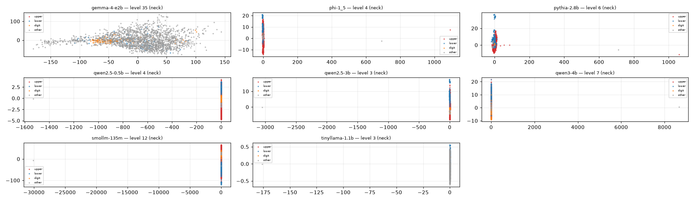
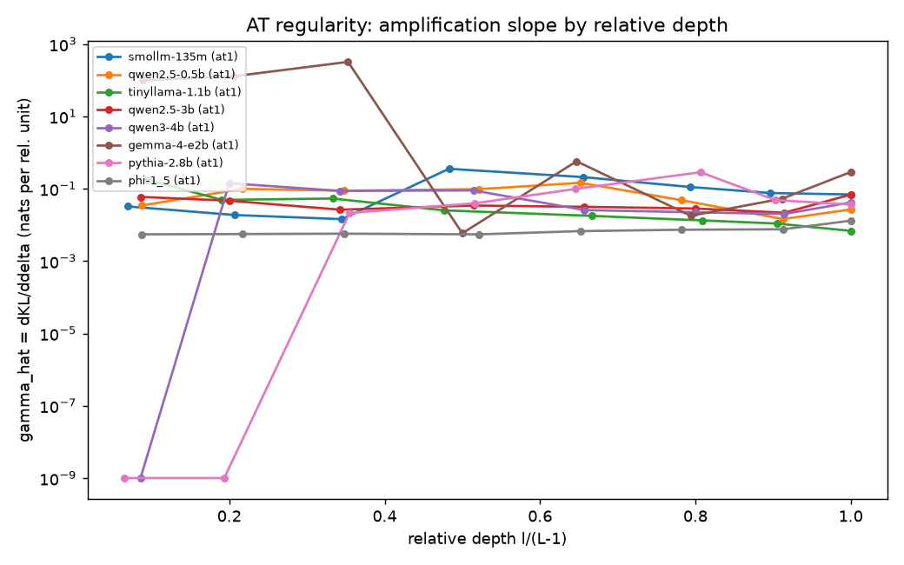
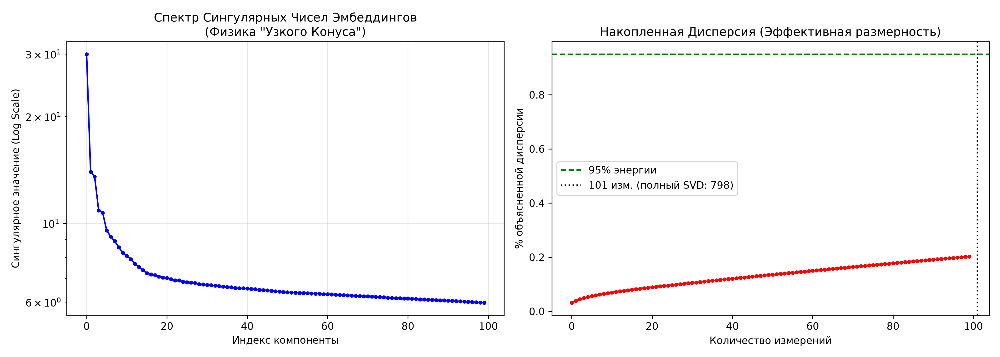

# Hourglass Lab

An empirical study of the "hourglass" in LLM hidden-state geometry: a low-dimensional "neck" mid-stack, embedding anisotropy, and architectural interference as an implicit regularizer. Eight base models across five architecture families (0.135B–5.12B).



## What is studied

Three-level geometry: weights (**W**), hidden representations (**X**) and function (**F**).
The levels are only partially dependent, and the "hourglass" (the bottleneck in the middle of the stack) —
a regular property of all model families.

- **Neck** — PCA of the middle layers: a low-dimensional subspace between input and output blocks;
- **Anisotropy / mass pressure** — effective rank, PR profiles per model and layer;
- **Architectural interference** — analogy theorems (AT-1…AT-4) against null models.

## Structure

```
hourglass-lab/
├── tvu_common.py          # shared path & model module ($MODELS_DIR)
├── code/                  # main work: 72 scripts + bat launchers
├── data/                  # run results: 41 metrics JSON + 28 article PNG figures
└── hourglass-anatomy/     # concept check v1–v4 (CPU) + results/
```

Two parts:

- **`code/`** — the main work (aiir-hourglass): 8 models (Qwen2.5-0.5B / Qwen2.5-3B /
  Qwen3-4B, TinyLlama-1.1B, Pythia-2.8B, Phi-1_5, SmolLM-135M, Gemma-4-E2B). Experiments
  Exp5–Exp10c, analogy theorems (AT-1…AT-4), null models, correlation analysis.
  Shared path module — `tvu_common.py` at the repository root; all scripts locate the root via it.
- **`hourglass-anatomy/`** — concept check v1–v4 on Qwen2.5-0.5B (CPU): narrow cone,
  mass pressure, anisotropy, layer-wise spectrum. `results/` — plots and run JSONs.

## Key results

- **Analogy theorems (AT-1…AT-4)** — γ profile: geometric structure transfers between models.

  

- **Concept check v1–v4** — narrow activation cone on SVD, Qwen2.5-0.5B (CPU).

  

## Data (`data/`)

Run metrics (41 `*.json` files) and all article figures (28 `*.png` files).
The `"path"` fields in the JSONs — paths relative to the original project tree root
(`models/<model>`); raw activation dumps (`*.npz`, >2 GB) are not included in the repository —
they are reproduced by scripts `code/run_exp10c_activation_dump.py`,
`run_at3_full_theorem.bat` etc.

## How to reproduce

1. Environment: `torch`, `transformers>=5.17` (required for Gemma-4-E2B),
   `numpy`, `matplotlib`, `scikit-learn`.
2. Models — via the `MODELS_DIR` environment variable (a folder containing per-model subfolders;
   understood by both `tvu_common.py` and anatomy v1–v4), or place a clone in a tree where a
   `models/` folder sits next to the repository root. For anatomy v1–v4 the default is
   `<repo root>/models/qwen2.5-0.5b` (or the same `MODELS_DIR`). Without models, scripts of the
   main part report this immediately on startup.
3. GPU scripts run on CUDA cuda:1; fully close LM Studio before a run
   (a background instance holds VRAM). CPU scripts (correlations, null models, Exp10c stage B) — no GPU needed.
4. Bat files in `code/` launch experiments end to end: `at1_analogy_theorem.bat`,
   `run_exp10_activation_structure_8m.bat`, `run_exp10c_activation_dump.bat` etc.

## Articles on nonndazone.ru

- [Architectural asymmetry and three-level geometry in large language models (RU)](https://nonndazone.ru/article/arhitekturnaya-asimmetriya-i-tryohurovnevaya-geometriya-v-bolshih-yazykovyh-modelyah)
- [Architectural Interference as an Implicit Regularizer: Hourglass Geometry in Large Language Models (EN)](https://nonndazone.ru/article/architectural-interference-as-an-implicit-regularizer-hourglass-geometry-in-large-language-models)
- [Architektonische Interferenz als impliziter Regularisierer: Stundenglas-Geometrie in großen Sprachmodellen (DE)](https://nonndazone.ru/article/architektonische-interferenz-als-impliziter-regularisierer-stundenglas-geometrie-in-gro%C3%9Fen-sprachmodellen)
- [架构干涉作为隐式正则化器：大语言模型中的沙漏几何 (ZH)](https://nonndazone.ru/article/%E6%9E%B6%E6%9E%84%E5%B9%B2%E6%B6%89%E4%BD%9C%E4%B8%BA%E9%9A%90%E5%BC%8F%E6%AD%A3%E5%88%99%E5%8C%96%E5%99%A8%E5%A4%A7%E8%AF%AD%E8%A8%80%E6%A8%A1%E5%9E%8B%E4%B8%AD%E7%9A%84%E6%B2%99%E6%BC%8F%E5%87%A0%E4%BD%95)
- **Preprint** — [Zenodo DOI 10.5281/zenodo.24246261](https://doi.org/10.5281/zenodo.24246261)

## License

Apache-2.0 (see `LICENSE`).
